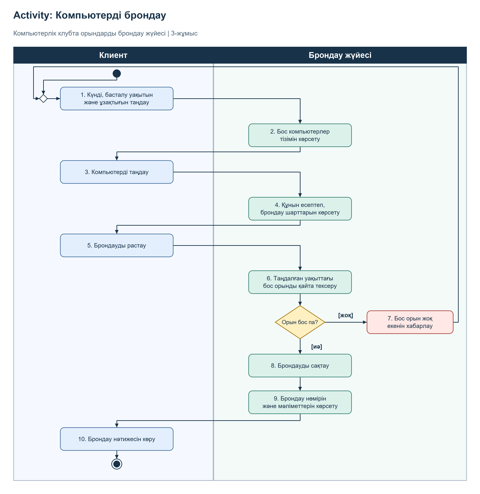
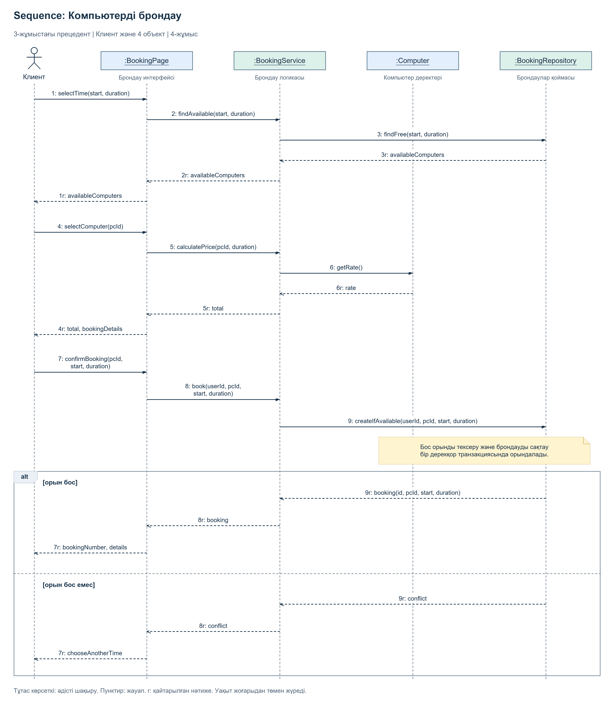

# Компьютерлік клубта орындарды брондау жүйесі

Автор: **Ауесқан Қайыржан**, **ВТПО-24-1б**  
GitHub: [QAWSADD](https://github.com/QAWSADD)

## Мәселе

Компьютерлік клубқа келген клиентке бос компьютер мен қолайлы уақытты алдын ала білу қиын болуы мүмкін. Әкімші брондауларды қолмен жүргізгенде бір орынға бірнеше тапсырыс тіркелуі ықтимал. Жоба клиентке бос орынды таңдап, брондау жасауға, ал әкімшіге компьютерлер мен брондауларды басқаруға арналған.

## Акторлар

- **Клиент**: бос компьютерлерді қарайды, уақытты таңдайды және брондауды растайды.
- **Әкімші**: компьютерлерді, тарифтерді және брондауларды басқарады.

## Талаптар

### Функционалдық

1. Жүйе күн, басталу уақыты және ұзақтығы бойынша бос компьютерлерді көрсетуі керек.
2. Жүйе таңдалған компьютердің тарифіне және ұзақтығына сәйкес құнын есептеуі керек.
3. Жүйе растау кезінде орынның бос екенін қайта тексеріп, тексеру мен сақтауды бір транзакцияда орындауы керек.
4. Жүйе бір компьютерге уақыттары қабаттасатын белсенді брондауларды тіркемеуі керек.
5. Жүйе сәтті брондауға бірегей нөмір беріп, оның мәліметтерін клиентке көрсетуі керек.
6. Әкімші компьютердің қолжетімділігін және тарифін өзгерте алуы керек.

### Функционалдық емес

1. Клиент пен әкімшінің қолжетімділік құқықтары бөлек болуы керек.
2. Қате туралы хабарламалар түсінікті тілде көрсетілуі керек.
3. Брондау деректері дерекқорда сақталып, жүйе қайта іске қосылғанда жоғалмауы керек.

Бұл бөлімдер болашақ жүйенің талаптарын сипаттайды. Қолданбаның коды кейін `src/` қалтасына қосылады.

## Диаграммалар

### 1. Use Case

Кейін қосылады: `docs/diagrams/01-usecase.drawio` және `01-usecase.png`.

### 2. Class

Кейін қосылады: `docs/diagrams/02-class.drawio` және `02-class.png`.

### 3. Activity: Компьютерді брондау

**Прецедент:** клиенттің компьютерлік клубта компьютерді белгілі бір уақытқа брондауы.

**Алғышарт:** клиент тіркелгісімен кірген; компьютерлер мен тарифтер жүйеге енгізілген. Жүйеге кіру бұл диаграмманың бөлігі емес.



[Өңделетін draw.io файлы](docs/diagrams/03-activity.drawio) · [PNG суреті](docs/diagrams/03-activity.png)

Диаграммада екі жауапкершілік жолы бар: **Клиент** және **Брондау жүйесі**. Онда бастау мен аяқтау белгілері, **10 әрекет**, шешім ромбы және `[иә]` / `[жоқ]` шарттары көрсетілген. Сол жақтағы кіші ромб бастапқы және қайталанатын жолдарды біріктіреді.

Негізгі жол: клиент уақыт пен компьютерді таңдайды, құнын көріп брондауды растайды; жүйе бос орынды қайта тексеріп, брондауды сақтайды және нөмірін көрсетеді. Егер растауға дейін орынды басқа клиент брондап қойса, жүйе хабарлама көрсетіп, клиентті уақытты қайта таңдауға қайтарады.

**Нәтиже:** брондау сақталып, клиент оның нөмірі мен мәліметтерін көреді. Бос орын болмаған жағдайда брондау жасалмайды. Қолданба жасалғанда бос орынды қайта тексеру мен сақтауды бір дерекқор транзакциясында орындау жоспарланған.

### 4. Sequence: Компьютерді брондау

**Прецедент:** 3-жұмыстағыдай клиенттің компьютерді белгілі бір уақытқа брондауы. Клиент жүйеге алдын ала кірген.



[Өңделетін draw.io файлы](docs/diagrams/04-sequence.drawio) · [PNG суреті](docs/diagrams/04-sequence.png)

Диаграмманың сол жағында **Клиент** акторы, одан кейін төрт объект орналасқан:

| Объект | Жауапкершілігі |
| --- | --- |
| `:BookingPage` | Клиенттің таңдауын қабылдау және нәтижені көрсету |
| `:BookingService` | Бос компьютерлерді іздеу, құнын есептеу және брондауды ұйымдастыру |
| `:Computer` | Таңдалған компьютердің тарифін беру |
| `:BookingRepository` | Бос орынды тексеру және брондауды дерекқорда сақтау |

Әр қатысушының пунктир өмір сызығы бар. Уақыт жоғарыдан төмен қарай жүреді. **Тұтас көрсеткілер** әдіс шақыруларын, **пунктир көрсеткілер** қайтарылған нәтижелерді білдіреді. Негізгі шақырулар `1`-ден `9`-ға дейін нөмірленген; `3r` сияқты белгі тиісті шақырудың жауабын көрсетеді. Жауаптарда әдіс атауының орнына қайтарылатын дерек жазылған.

Негізгі әдіс шақырулары:

1. `selectTime(start, duration)` - клиент брондау уақытын таңдайды.
2. `findAvailable(start, duration)` - интерфейс сервистен бос компьютерлерді сұрайды.
3. `findFree(start, duration)` - сервис қоймадан бос компьютерлер тізімін алады.
4. `selectComputer(pcId)` - клиент компьютерді таңдайды.
5. `calculatePrice(pcId, duration)` - сервис брондау құнын есептейді.
6. `getRate()` - таңдалған компьютер өз тарифін береді.
7. `confirmBooking(pcId, start, duration)` - клиент брондауды растайды.
8. `book(userId, pcId, start, duration)` - сервис брондау сұрауын өңдейді.
9. `createIfAvailable(userId, pcId, start, duration)` - қойма бос орынды қайта тексеріп, тек бос болса брондауды сақтайды.

Мұндағы `start` - басталу күні мен уақыты, `duration` - минутпен берілген ұзақтық, `pcId` - компьютер идентификаторы, `userId` - тіркелген клиент идентификаторы. `getRate()` тарифі бір минутқа беріледі; есептелген `total` - клиентке көрсетілетін жалпы құн.

**`alt` блогының екі шарты:**

- `[орын бос]`: қойма сақталған `booking` объектісін қайтарады; сервис пен интерфейс нәтижені клиентке жеткізеді. Клиент брондау нөмірі мен мәліметтерін көреді.
- `[орын бос емес]`: қойма `conflict` нәтижесін қайтарады; клиентке басқа уақытты таңдау ұсынылады. Жаңа брондау сақталмайды; клиент Activity диаграммасындағыдай уақытты қайта таңдай алады.

`createIfAvailable(...)` бос орынды тексеру мен сақтауды **бір транзакцияда** орындайды: жүйені іске асырғанда бір компьютерге уақыттары қабаттасатын белсенді брондауларға жол берілмейді. Бұл - болашақ әдістің жобалық келісімі; қолданба коды әлі жазылған жоқ.

## Репозиторий құрылымы

```text
diploma-computer-club/
├── README.md
├── docs/
│   └── diagrams/
│       ├── 03-activity.drawio
│       ├── 03-activity.png
│       ├── 04-sequence.drawio
│       └── 04-sequence.png
└── src/
```

## Жұмыс күйі

- Репозиторий құрылымы мен жоба сипаттамасы дайын.
- **3-жұмыс:** Activity диаграммасы `.drawio` және `.png` форматтарында дайын.
- Use Case және Class бөлімдеріне орын қалдырылды.
- **4-жұмыс:** Sequence диаграммасы `.drawio` және `.png` форматтарында дайын; жеке коммитпен қосылған.
